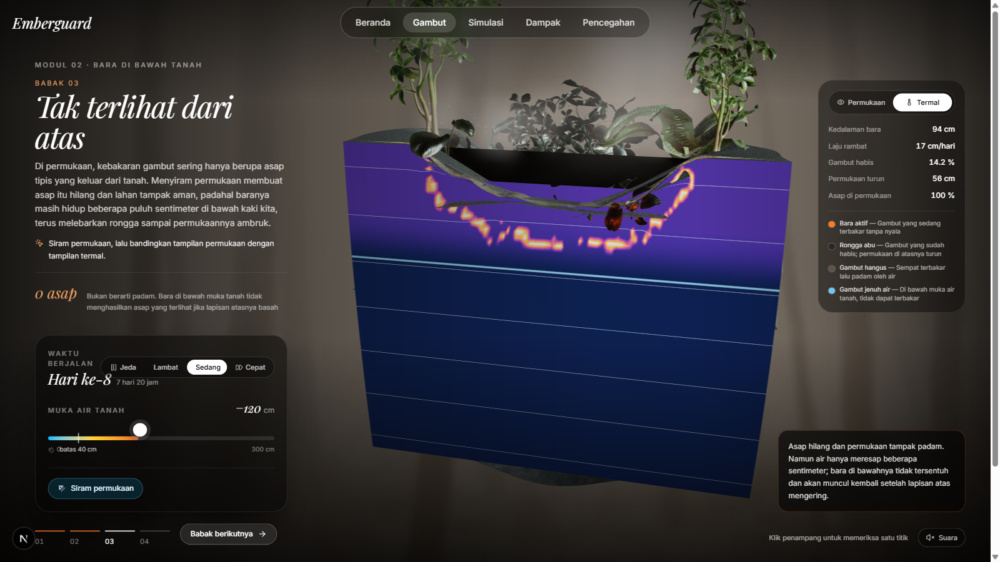

# Emberguard

**Media edukasi interaktif pencegahan kebakaran hutan dan lahan (karhutla) di Kalimantan Barat.**

Emberguard bukan situs artikel. Pembaca tidak *membaca tentang* kebakaran gambut —
mereka **menjalankannya sendiri**: menyulut bongkahan gambut, mempercepat waktu,
menyiram permukaan, lalu menyadari lewat citra termal bahwa baranya masih hidup
satu setengah meter di bawah kaki mereka.

Proyek ini disusun sebagai tugas akhir Program Studi Sistem Informasi (S1),
Universitas BSI.



---

## Sekilas Teknologi

| Lapisan | Teknologi |
|---|---|
| Bahasa | TypeScript 5 (`strict`), GLSL untuk peneduh (*shader*) |
| Kerangka kerja | Next.js 16.3.5 — App Router |
| Antarmuka | React 19.2.8, Tailwind CSS v4, lucide-react |
| Grafis 3D | Three.js 0.186, React Three Fiber 9, @react-three/drei 10 |
| Animasi | GSAP 3.15 + `useGSAP`, ScrollTrigger |
| Audio | Web Audio API (disintesis langsung, tanpa berkas suara) |
| Pengujian | Vitest 5 — 157 uji unit atas logika murni |
| Mutu kode | ESLint 9 (flat config) + `eslint-config-next` |

Seluruh perhitungan berjalan di peramban. Tidak ada basis data, tidak ada API
sisi server, tidak ada akun pengguna — sehingga hasil `next build` dapat
ditempatkan sebagai situs statis.

Rincian lengkap beserta alasan tiap pilihan ada di
**[docs/md/technology-used.md](docs/md/technology-used.md)**, sedangkan rancangan
cerita seluruh bagian ada di **[docs/md/storyboard.md](docs/md/storyboard.md)**.

---

## Menjalankan

```bash
npm install
npm run dev       # http://localhost:3000
```

Perintah lain:

```bash
npm run build     # build produksi
npm start         # menjalankan hasil build
npm test          # 157 uji Vitest
npm run lint      # ESLint
```

> **Mengukur performa harus memakai `npm run build` lalu `npm start`.**
> Server pengembangan (`npm run dev`) kira-kira dua kali lebih lambat karena
> menyusun berkas saat diminta; angka fps dari sana tidak mewakili keadaan
> sebenarnya.

Untuk menguji dari ponsel di jaringan yang sama, tambahkan alamat IP laptop
(lihat `ipconfig`) ke `allowedDevOrigins` pada `next.config.ts`. Tanpa itu,
halaman termuat tetapi tombolnya tidak merespons.

---

## Struktur

```
app/                 Rute (App Router). Tiap page.tsx = satu URL.
components/          Komponen antarmuka dan adegan 3D.
  gambut/scene/        Bagian 3D yang dipakai bersama semua modul.
  gambut/anatomi/      Modul 01.
  gambut/bara/         Modul 02.
  gambut/kanal/        Modul 03.
  gambut/karbon/       Modul 04.
config/              Seluruh teks Bahasa Indonesia, terpisah dari kode.
hooks/               Hook React yang dipakai ulang.
lib/                 Logika murni: tanpa React, tanpa Three.js, tanpa DOM.
public/              Model .glb dan tekstur .webp beserta berkas sumbernya.
docs/md/             Dokumentasi teknis.
docs/screenshots/    Tangkapan layar hasil pengujian.
```

Pemisahan yang paling menentukan ada pada `lib/`: seluruh model ilmiahnya
diletakkan di sana tanpa satu pun impor React atau Three.js, sehingga dapat
diuji otomatis di lingkungan Node dan dikutip sebagai algoritma pada naskah.

---

## Isi

| | Modul | Keadaan |
|---|---|---|
| 01 | **Anatomi Gambut** — mengupas lapisan fibrik, hemik, saprik, dan tanah mineral mengikuti gulir halaman | Selesai |
| 02 | **Bara di Bawah Tanah** — ruang uji perambatan bara pada bidang penampang | Selesai |
| 03 | **Kanal & Pengeringan** — satu kanal digali, dan pengaruhnya diikuti sampai satu kilometer ke dalam kubah gambut | Selesai |
| 04 | **Gudang Karbon** — bidang potong yang sama dibaca sebagai kalender dan sebagai gudang karbon | Selesai |

Keempat modul memakai pola yang sama: empat babak berurutan, dan babak
berikutnya hanya terbuka setelah pembaca benar-benar mengerjakan tugas babak
yang sedang dibukanya — bukan setelah menekan "lanjut".

Bagian **Simulasi**, **Dampak**, dan **Pencegahan** masih berupa halaman
penanda.

---

## Model Simulasi

Tiap modul berdiri di atas satu model di `lib/`, dan model itu tidak pernah
mengimpor React atau Three.js:

| Modul | Model | Yang dihitung |
|---|---|---|
| 01 | [`lib/peat.ts`](lib/peat.ts) | Klasifikasi lapisan menurut kedalaman, status muka air, indeks bahaya |
| 02 | [`lib/smolder.ts`](lib/smolder.ts) | Perambatan bara pada bidang penampang |
| 03 | [`lib/drainage.ts`](lib/drainage.ts) | Kerucut penurunan muka air sepanjang 1 km, subsiden, dan emisi per tahun |
| 04 | [`lib/carbon.ts`](lib/carbon.ts) | Cadangan karbon, CO₂ yang lepas, umur gambut menurut kedalaman, lama pemulihan |

### Modul 02 — perambatan bara

Model yang paling besar ada pada [`lib/smolder.ts`](lib/smolder.ts): sel-otomata
(*cellular automaton*) dua dimensi pada bidang penampang gambut, berukuran
96 × 56 sel yang mewakili bongkahan 4,4 m × 3,4 m.

Yang dimodelkan:

- **Kematangan gambut** menentukan lama bakar dan kecepatan rambat — fibrik
  berpori cepat menyambar, saprik padat merambat lambat tetapi awet.
- **Kelembapan kapiler** dihitung dari kedalaman muka air tanah. Di atas ambang
  0,55 gambut tidak dapat menyala, dan bara yang sudah ada akan padam.
- **Arah rambat tak simetris**: bara paling mudah turun, paling sulit naik.
- **Pembatasan oksigen**: makin dalam terkubur dari rongga yang menyambung ke
  permukaan, makin lambat membara — tetapi tidak pernah berhenti total.
- **Subsiden**: 62% volume hilang saat gambut menjadi abu, dan permukaan tanah
  pada adegan 3D benar-benar melesak mengikutinya.
- **Penyiraman permukaan** hanya membasahi 25 cm teratas dan menguap dalam dua
  setengah hari — cukup untuk menghentikan asap, tidak cukup untuk memadamkan
  bara. Inilah pelajaran utama modul ini.

Langkah waktunya tetap (15 menit simulasi per langkah) sehingga hasilnya tidak
bergantung pada kecepatan perangkat, dan bilangan acaknya ber-*seed* sehingga
tangkapan layar dapat direproduksi.

### Modul 03 — hidrologi kanal

[`lib/drainage.ts`](lib/drainage.ts) menarik kamera ke belakang: penampang
lanskap sepanjang **satu kilometer**, karena pada bongkahan 4,4 m kerucut
penurunan muka air hanya akan tampak sebagai garis datar. Panjang pengaruh
satu kanal dihitung sebanding dengan kedalamannya, laju subsiden dan emisi
sebanding dengan kedalaman muka air setempat, dan pemadatan awal yang lebih
cepat pada dua tahun pertama dipisahkan dari oksidasi jangka panjang.

### Modul 04 — gudang karbon

[`lib/carbon.ts`](lib/carbon.ts) menghitung dua arah dari bidang potong yang
sama. Ke bawah sebagai **kalender**: satu milimeter setahun, jadi kedalaman
dapat dibaca sebagai umur. Dan sebagai **gudang**: 55 kg karbon tiap meter
kubik, sehingga yang lepas saat terbakar ditentukan oleh luas **dikali**
kedalaman — bukan oleh luas saja, yang justru satu-satunya angka yang
biasanya diberitakan.

### Tentang angka-angkanya

Nilai-nilai tetapan bersifat ilustratif: besarannya dipilih agar sesuai urutan
besar pengamatan lapangan, bukan hasil kalibrasi terhadap satu lokasi tertentu.

Pada `drainage.ts` dan `carbon.ts`, seluruh tetapan kuantitatif yang **belum
memiliki sumber** dikumpulkan dalam satu blok bertanda di kepala berkas, bukan
disebar ke dalam kode, dan diurutkan menurut besar pengaruhnya pada kesimpulan
yang dibawa pembaca. Dengan begitu semuanya dapat diganti sekaligus begitu
rujukannya ada. Angka-angka itu belum boleh dikutip sebagai temuan.

---

## Sumber & Atribusi

- Klasifikasi fibrik / hemik / saprik mengikuti **USDA Soil Taxonomy**.
- Ketebalan minimum 50 cm agar suatu lahan disebut gambut merujuk **PP No. 71
  Tahun 2014** tentang perlindungan dan pengelolaan ekosistem gambut.
- Batas muka air tanah 0,4 m merujuk **PP No. 57 Tahun 2016**, perubahan atas
  PP No. 71 Tahun 2014.
- Sumber dan lisensi tiap aset tercatat pada
  [`public/models/gambut/SUMBER.md`](public/models/gambut/SUMBER.md) dan
  [`public/textures/gambut/SUMBER.md`](public/textures/gambut/SUMBER.md).

Dokumen skripsi, berkas administrasi kampus, serta jurnal rujukan tidak
disertakan dalam repositori ini karena bersifat pribadi atau berhak cipta.
